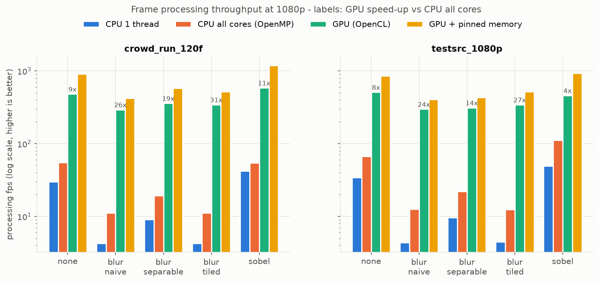
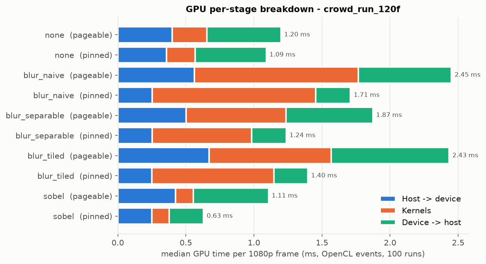
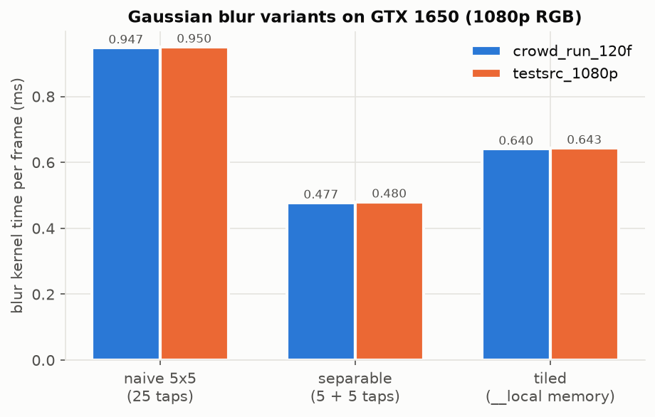
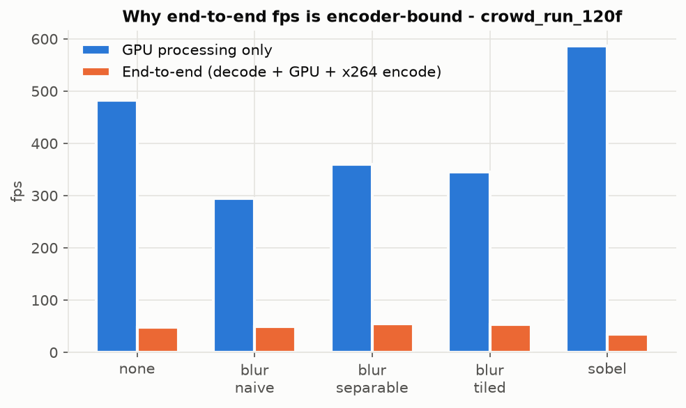
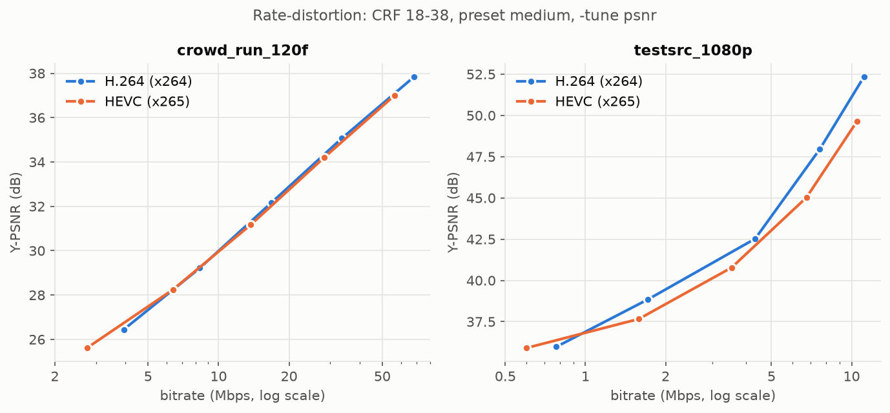
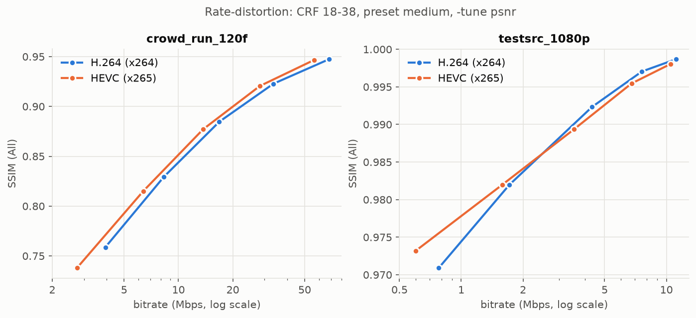
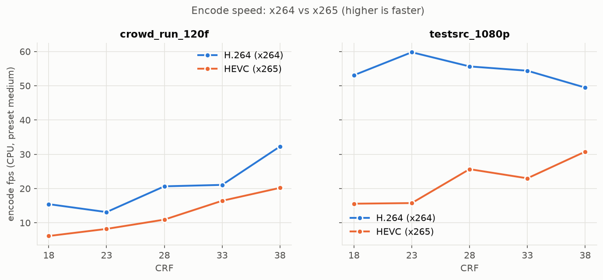

# gpu-video-pipeline

**GPU-accelerated video processing & quality pipeline**: C++17 · FFmpeg · OpenCL · x264/x265

A C++17 pipeline that **decodes real video with FFmpeg (libavcodec), processes every frame on the GPU with custom OpenCL kernels, re-encodes it with x264/x265, and measures both speed and quality**. Every GPU kernel has a CPU reference implementation, and GPU output is validated against it on every frame. The result is **bit-exact**: max abs diff 0 on every frame tested.

```
input.y4m / .mp4
   │  FFmpeg decode (libavformat + libavcodec, sws_scale → YUV420P)
   ▼
[ GPU · OpenCL 1.2 ]
   YUV420P → RGB        BT.709 limited range
   RGB filter           Gaussian 5×5 (naive / separable / local-memory tiled) or Sobel on luma
   RGB → YUV420P        BT.709, 2×2 chroma averaging
   ▼
   FFmpeg encode (libx264 / libx265) → output.mp4
   ▼
Benchmark (CPU vs GPU, per-stage ms via OpenCL events) + Quality (PSNR / SSIM / BD-rate)
```

All numbers below were **measured on one laptop**: NVIDIA GeForce GTX 1650 (4 GB, 14 CUs) and Intel Core i5-10300H (4 cores / 8 threads), Windows 11. The raw data is in [results/](results/).

---

## Results

Test clips (1080p, 120 frames each): `crowd_run` (real content, Xiph derf collection, 50 fps) and `testsrc2` (FFmpeg synthetic, 30 fps).

### 1. Frame processing throughput, CPU vs GPU (1080p, `crowd_run`)

Processing = colour conversion + filter + colour conversion, per frame. GPU figures include host↔device transfers. Median over 115 frames after 5 warm-up frames.

| Filter | CPU 1 thread | CPU 8 threads (OpenMP) | GPU (OpenCL) | GPU + pinned memory | GPU vs CPU 8T |
|---|---:|---:|---:|---:|---:|
| none (YUV→RGB→YUV) | 30.1 fps | 54.9 fps | 482 fps | 909 fps | 8.8× |
| blur_naive | 4.3 fps | 11.2 fps | 294 fps | 421 fps | 26× |
| blur_separable | 9.1 fps | 19.4 fps | 360 fps | 578 fps | 19× |
| blur_tiled | 4.3 fps\* | 11.1 fps\* | 345 fps | 518 fps | 31× |
| sobel (luma) | 42.0 fps | 54.5 fps | 586 fps | 1190 fps | 11× |

\* Tiling is a GPU memory optimisation, so the CPU path for `blur_tiled` runs the same naive 5×5 code.



### 2. Isolated GPU timing (`kernel_bench`, median of 100 back-to-back runs, `crowd_run` frame)

| Filter | H2D | Kernels | D2H | Total | Total (pinned) |
|---|---:|---:|---:|---:|---:|
| none | 0.399 ms | 0.255 ms | 0.545 ms | 1.216 ms | 1.078 ms |
| blur_naive | 0.563 | 1.202 | 0.685 | 2.461 | 1.714 |
| blur_separable | 0.503 | 0.732 | 0.639 | 1.886 | 1.246 |
| blur_tiled | 0.672 | 0.895 | 0.868 | 2.463 | 1.406 |
| sobel | 0.425 | 0.129 | 0.554 | 1.132 | 0.640 |

- **Transfers cost more than the kernels.** For most filters, moving a 3.1 MB YUV frame in and out takes longer than processing it.
- **Pinned memory** (`CL_MEM_ALLOC_HOST_PTR`) cut H2D + D2H from 1.14 ms to 0.51 ms per frame (**2.2× faster**, `blur_separable`).



### 3. Gaussian blur variants (blur kernel only, colour conversion subtracted)

| Variant | Taps / pixel / channel | Kernel time | vs naive |
|---|---:|---:|---:|
| naive 2-D 5×5 | 25 | 0.947 ms | 1.00× |
| separable (H then V, 16-bit intermediate) | 5 + 5 | **0.477 ms** | **1.99×** |
| tiled (16×16 tile + 2-px halo in `__local`) | 25 (from local memory) | 0.640 ms | 1.48× |

All three produce **identical** output (integer weights, `(sum+128)>>8`). Tiling helped (1.48×), but separable filtering helped more. My interpretation: the GTX 1650's L1/texture cache already captures much of the naive kernel's neighbour reuse, while separable filtering removes 60% of the arithmetic and memory reads.



### 4. End-to-end fps is encoder-bound (honest view)

| `crowd_run`, blur_separable | fps |
|---|---:|
| GPU processing only | 360 |
| End-to-end GPU (decode + GPU + x264 `veryfast` encode, incl. flush) | **54.5** |
| End-to-end CPU 8T | 16.6 |

The GPU processes a frame in about 3–4 ms, but decode + x264 encode on the CPU take most of the frame time. **The kernel speed-up (19×) is not the end-to-end speed-up (3.3×).** This is expected, and it is why GPU pipelines move the encoder onto hardware (NVENC) too.



### 5. Validation

| Check | Result |
|---|---|
| GPU vs CPU, all 5 filters × 2 clips × 120 frames | **max_abs_diff = 0, PSNR = ∞ (bit-exact)** → [validation.csv](results/validation.csv) |
| Unit test `test_cpu_vs_gpu` (random 1080p frame, pageable + pinned) | 10/10 pass, max_abs_diff = 0 |
| YUV→RGB→YUV round trip, Y mean abs error | 0.0041 on `crowd_run`, 0.37 on synthetic noise (limit 2.0) |
| Own C++ PSNR vs FFmpeg `psnr` filter | **0.0000 dB difference** on both clips → [psnr_crosscheck.csv](results/psnr_crosscheck.csv) |

The match is bit-exact because the kernels use `#pragma OPENCL FP_CONTRACT OFF` (no fused multiply-add) and Sobel is built with `-cl-fp32-correctly-rounded-divide-sqrt`, so GPU float rounding matches MSVC's `/fp:precise`.

### 6. H.264 (x264) vs HEVC (x265) rate-distortion

CRF {18, 23, 28, 33, 38}, preset `medium`, 2 clips × 2 codecs × 5 CRF = 20 encodes per tuning → [rd_results.csv](results/rd_results.csv).

**BD-rate of HEVC relative to H.264** (Y-PSNR, cubic fit; negative = HEVC needs less bitrate) → [bd_rate.csv](results/bd_rate.csv)

| Clip | Default tuning (psy-rd / AQ on) | `-tune psnr` (both encoders) |
|---|---:|---:|
| crowd_run (real) | **−9.1%** | +1.5% |
| testsrc2 (synthetic) | +4.4% | +15.4% |

| Average encode speed (preset medium, `-tune psnr`) | x264 | x265 |
|---|---:|---:|
| crowd_run | 20.5 fps | 12.4 fps (1.7× slower) |
| testsrc2 | 54.5 fps | 22.1 fps (2.5× slower) |

**Interpretation.** On these short 120-frame clips at preset `medium`, x265 gave only a small bitrate saving on real content (−9.1%, default tuning) and none in the PSNR-tuned comparison, while costing 1.7–2.5× the encode time. This is smaller than HEVC's usually quoted ~25–50% savings. The likely reasons: very short sequences (HEVC's gains build up over long GOPs and B-frame hierarchies), only two clips, the high bitrates CRF 18–38 gives on `crowd_run`, and preset `medium` being a speed-oriented setting for x265. The numbers are reported as measured. The same CRF also doesn't mean the same quality across the two encoders, which is why BD-rate is used.





---

## Key engineering decisions

- **Coalesced indexing.** `get_global_id(0)` is the column, so neighbouring work-items read neighbouring bytes of a row.
- **One packed YUV buffer per frame.** Y, U and V are contiguous, so each frame needs one H2D and one D2H transfer instead of three of each. The decoder copies row by row using `AVFrame::linesize`, because FFmpeg pads rows for SIMD alignment.
- **Buffers allocated once** for the frame size and reused for every frame.
- **2×2 block per work-item in RGB→YUV420.** Each work-item writes 4 Y samples plus 1 U and 1 V, with no second pass and no atomics.
- **Separable blur keeps a 16-bit un-normalised intermediate**, so it is exactly equal to the 2-D version.
- **Tiled blur:** a cooperative load of a 20×20 tile into `__local` memory, a `barrier` before reading, and the early-return bounds check placed after the barrier (otherwise some work-items never reach it).
- **Pinned staging memory** gives the driver a DMA-able host buffer, so it can skip an extra copy into its own internal pinned buffer.
- **Benchmark methodology.** Timing runs and validation runs are separate. In an early run with `--validate`, the slow CPU reference left the GPU idle between frames, and the laptop GPU down-clocked: identical kernels varied by up to 6×. `kernel_bench` runs kernels back to back for stable kernel comparisons.
- **End-to-end fps** is computed from total wall time including the encoder flush. Per-call `encode()` time understates cost, because x264 buffers frames for lookahead and B-frames.

## Honest limitations

- Kernel speed-ups ≠ end-to-end speed-ups. The pipeline is limited by CPU decode and encode.
- The pipeline is serial: decode, GPU and encode don't overlap. Double-buffering or async transfers would raise end-to-end fps.
- The CPU baseline is plain C++ with OpenMP and no hand-written SIMD, so a hand-optimised CPU path would shrink the gap.
- Single GPU (laptop GTX 1650), OpenCL 1.2 API level, 120-frame clips. x264/x265 run on the CPU.
- Only 2 clips, one of them synthetic, so the BD-rate figures are not general claims about HEVC.
- Audio loudness (spec Phase 3) is not implemented.

## Build & run

### Windows (what was used here)
1. VS 2022 Build Tools (C++), CMake ≥ 3.20, Python 3.10+ with `pip install pandas matplotlib numpy`.
2. Extract into `third_party/` (gitignored):
   - `third_party/ffmpeg/`: [BtbN FFmpeg](https://github.com/BtbN/FFmpeg-Builds/releases) `ffmpeg-master-latest-win64-gpl-shared.zip`
   - `third_party/opencl/`: [Khronos OpenCL-SDK](https://github.com/KhronosGroup/OpenCL-SDK/releases) `OpenCL-SDK-*-Win-x64.zip`
3. Build and test:
```powershell
cmake -S . -B build -G "Visual Studio 17 2022" -A x64
cmake --build build --config Release
ctest --test-dir build -C Release
```
The FFmpeg DLLs and `kernels/` are copied next to the executables in `build/bin/`.

### Linux (untested)
The CMake file falls back to pkg-config on Linux, but this path has **not been built or run**. All results above are from the Windows build.
```bash
sudo apt install build-essential cmake pkg-config ffmpeg libavcodec-dev libavformat-dev \
  libavutil-dev libswscale-dev libswresample-dev ocl-icd-opencl-dev opencl-headers
cmake -S . -B build && cmake --build build -j && ctest --test-dir build
```

### Reproduce every number
```bash
python scripts/prepare_clips.py         # testsrc2 + first 120 frames of Xiph crowd_run → data/
python scripts/run_benchmarks.py        # benchmark_video.csv, validation.csv, kernel_bench.csv
python scripts/codec_rd_analysis.py     # rd_results.csv (tune psnr), psnr_crosscheck.csv
python scripts/codec_rd_analysis.py --tune none   # rd_results_tune-none.csv
python scripts/bd_rate.py               # bd_rate.csv
python scripts/plot_results.py          # results/figures/*.png
```

### CLI
```
video_pipeline --input <file> --output <file.mp4|none> --mode cpu|gpu|passthrough
               --filter none|blur_naive|blur_separable|blur_tiled|sobel
               --frames N --warmup 5 --codec libx264|libx265 --crf 23 --preset medium
               --cpu-threads N (0 = all) --pinned --validate --csv results/benchmark_video.csv
kernel_bench   --input <clip> [--runs 100 --warmup 20 --csv results/kernel_bench.csv]
yuv_psnr       <distorted> <reference>
```

## Repository layout
```
include/  src/        decoder, encoder, OpenCL context, CPU ops, GPU pipeline, metrics, CLIs
kernels/              yuv420p_to_rgb.cl, rgb_to_yuv420p.cl, gaussian_blur.cl, sobel.cl
tests/                test_color_roundtrip, test_cpu_vs_gpu, test_psnr (registered with CTest)
scripts/              prepare_clips, run_benchmarks, codec_rd_analysis, bd_rate, plot_results
results/              CSVs + figures/ (all measured)
```

## Environment
| | |
|---|---|
| GPU | NVIDIA GeForce GTX 1650, 4 GB, 14 CUs, 48 KB local mem, driver 516.40 (OpenCL 3.0 CUDA; code targets 1.2) |
| CPU | Intel Core i5-10300H, 4C/8T, 7.8 GB RAM |
| OS | Windows 11 |
| Compiler | MSVC 19.44 (VS 2022 Build Tools), C++17, `/O2 /fp:precise /openmp` |
| FFmpeg | BtbN master build N-127579 (libavcodec 63), libx264 core 165, libx265 |
| OpenCL SDK | Khronos OpenCL-SDK v2026.05.29 (headers + ICD loader lib) |
| Python | 3.11.9, pandas, matplotlib, numpy |
